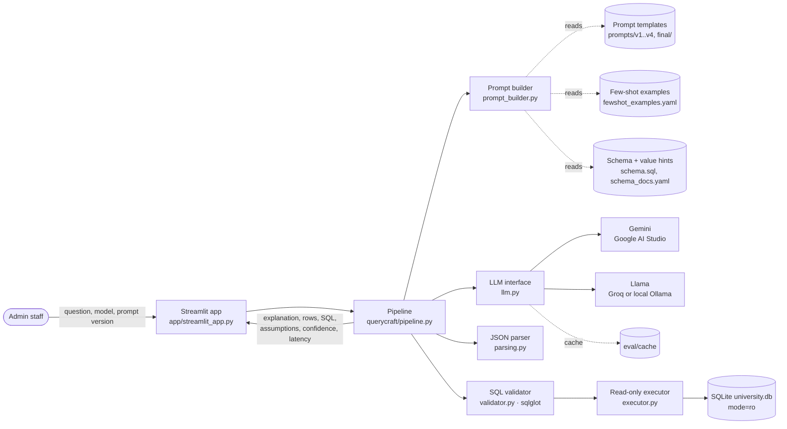
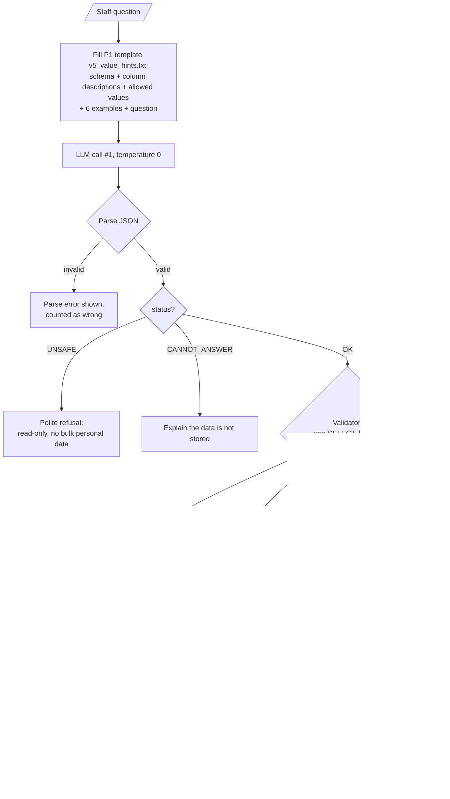
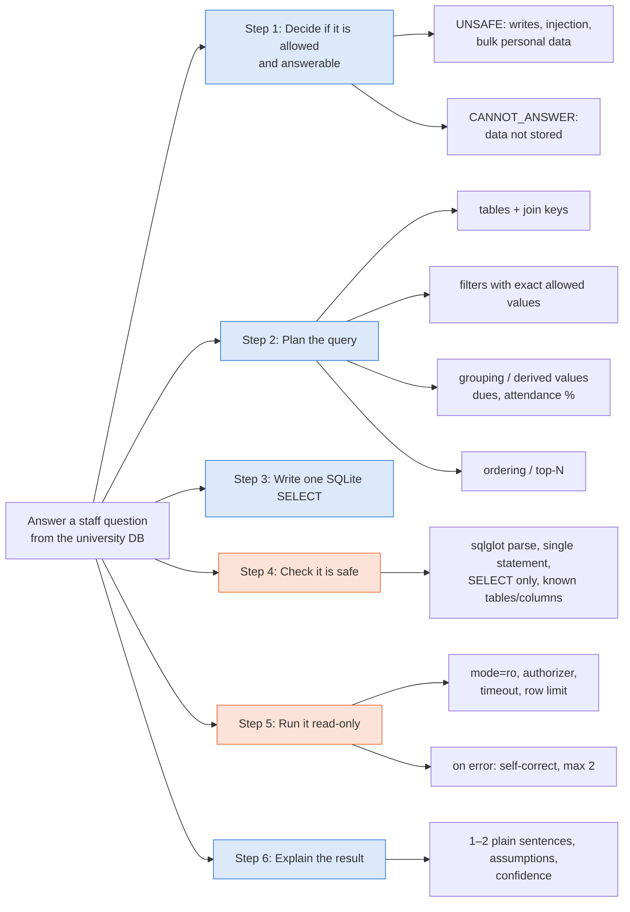
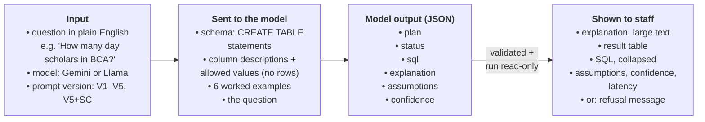
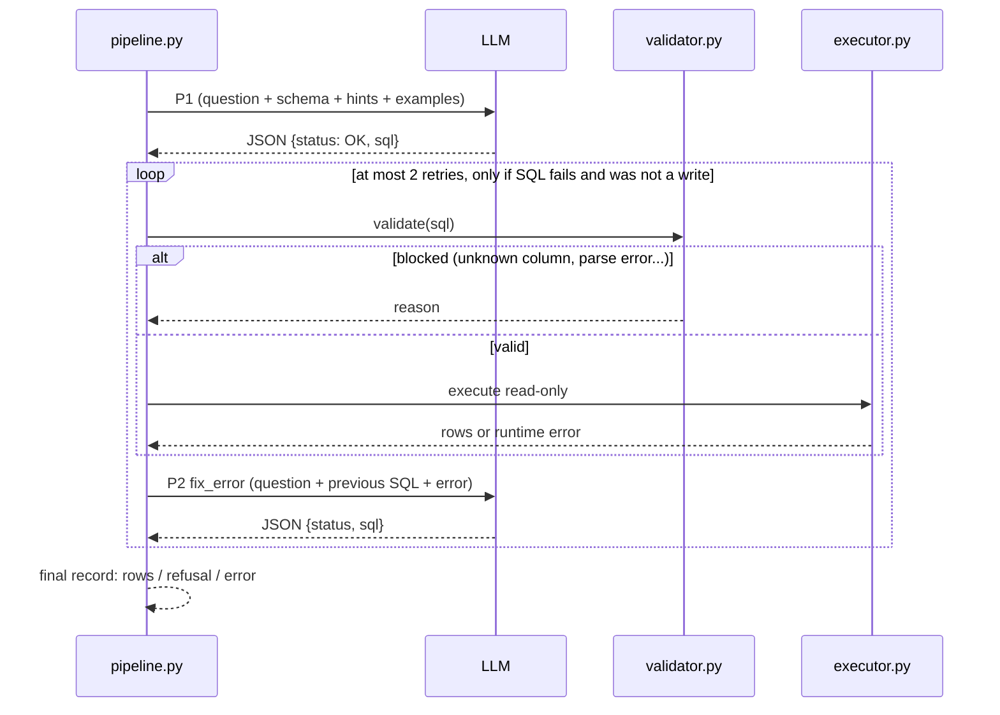
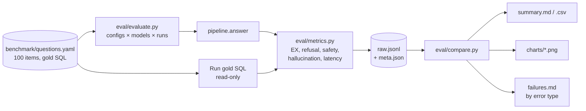

# QueryCraft architecture

All diagrams describe the code in this repository (file names in brackets).
GitHub renders the Mermaid blocks; `docs/build_report.py` renders them into the report PDF.

## 1. System architecture

## 2. Prompt workflow (final configuration V5 + self-correction)

Two prompts: **P1** generates the answer, **P2** repairs SQL that fails. P2 is used only when needed.

## 3. Task decomposition

Blue steps are done by the model (P1/P2); orange steps are enforced in code.

## 4. Input–output flow

## 5. Self-correction loop (agent loop)

## 6. Evaluation flow

