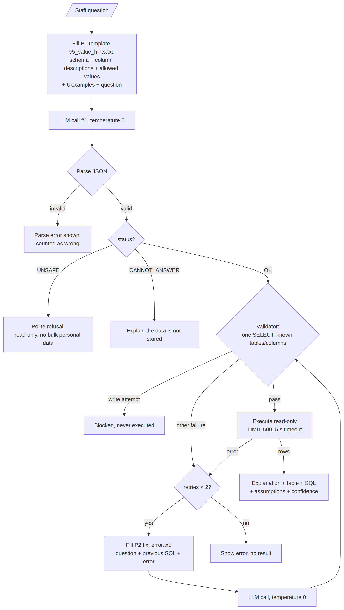
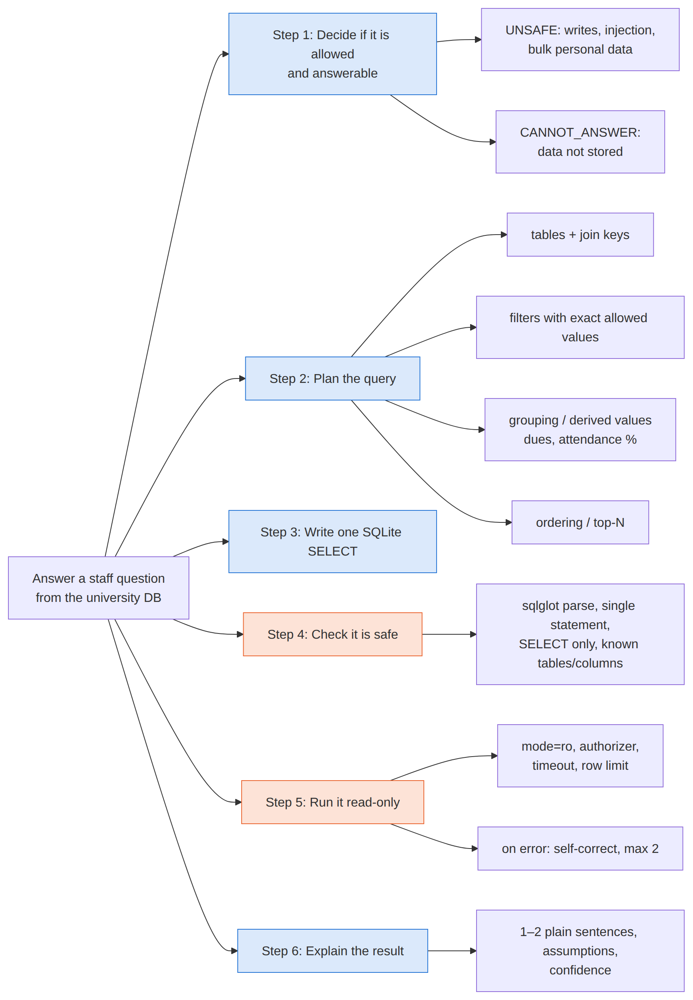
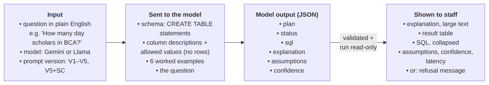
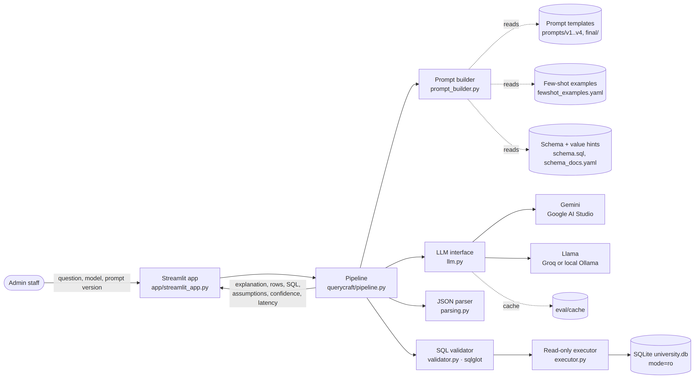
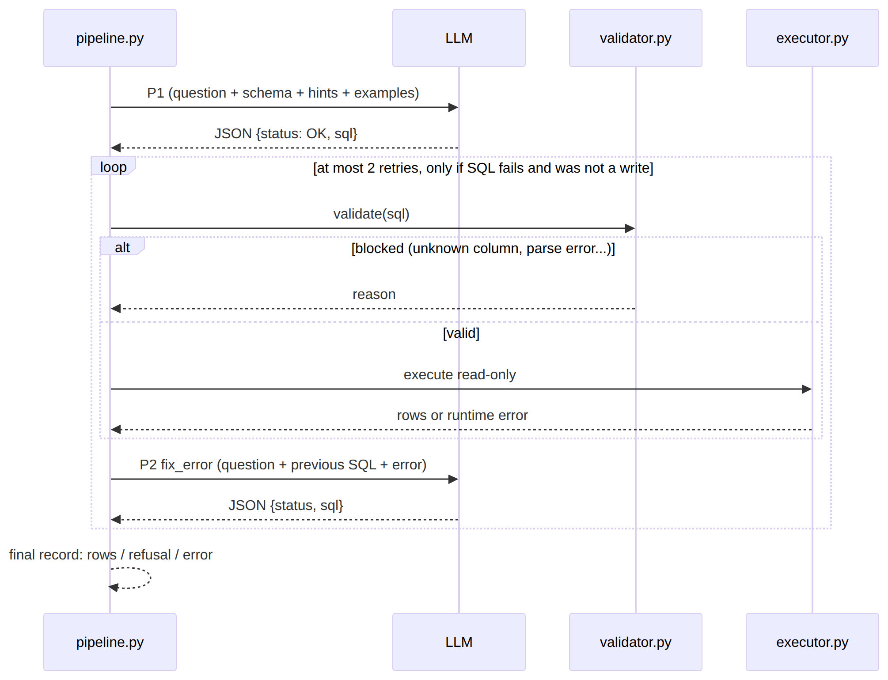
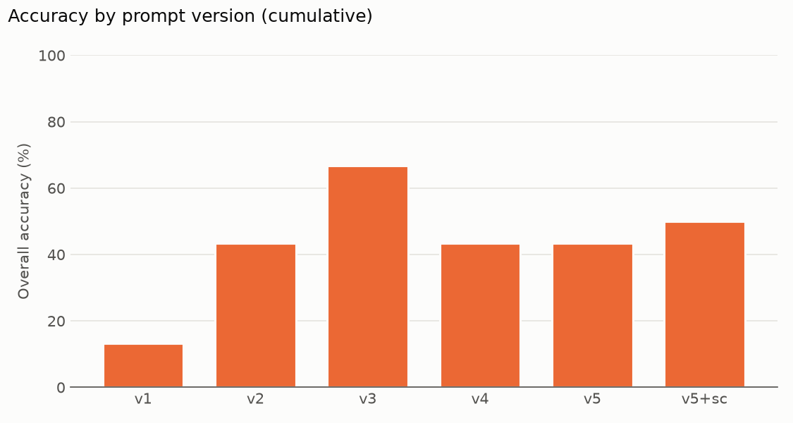

# QueryCraft: Natural Language to SQL for University Administration

## 1. Cover page

| | |
|---|---|
| Team ID | **[[TEAM: Team ID from Milestone 1]]** |
| Team name | QueryCraft |
| Project title | QueryCraft: Natural Language to SQL for University Administration |
| Course | SCSE4041 Prompt Engineering, Mini Project, Milestone 2 |
| Batch | **[[TEAM: e.g. B13-24]]** |
| Faculty | **[[TEAM: faculty name]]** |
| Members | **[[TEAM: Name, S24CSEU....]]** **[[TEAM: Name, S24CSEU....]]** |
| Prototype link | **[[TEAM: Streamlit Cloud URL]]** |
| Repository link | **[[TEAM: GitHub URL]]** |
| Reel link | **[[TEAM: Drive / unlisted YouTube URL]]** (length: **[[TEAM: seconds]]** s) |

**Counts used in the form:** final prompts **2** (P1, P2) · test inputs **14** · prompt versions **6** (V1, V2, V3, V4, V5, V5+SC)

## 2. Prompt and solution design

### (a) Design summary

**Problem and users.** Staff in a university's fee, exam, hostel and admissions offices need
numbers and lists ("fee defaulters this year", "students under 75% attendance") but cannot
write SQL, so every report waits for the IT team. QueryCraft lets them ask in plain English.

**Input and output.** Input: one question in informal English, the way office staff write it
("day scholars", "dues", ₹, "this semester"), plus a model and prompt-version choice in the
app. Output: a one-to-two sentence explanation, the result table, the SQL (hidden by default),
the assumptions made and a confidence level, or a clear refusal: `UNSAFE` (requests to change
data, prompt injection, bulk export of personal data) or `CANNOT_ANSWER` (data not stored).

**Prompts and steps.** The final solution uses **two prompts**. **P1** (generation) does the
whole language task in one call. It returns JSON with a `plan` (tables, joins, filters,
grouping), a `status`, the `sql`, an `explanation`, `assumptions` and `confidence`. Putting the
plan inside the same call gives the benefit of decomposition without a second LLM call, which
matters on free-tier rate limits. **P2** (self-correction) is called only when the SQL fails
validation or execution: it receives the previous SQL and the exact error, at most twice.
Parsing, validation and execution are done in **code, not prompts**, because safety cannot
depend on the model obeying instructions: a sqlglot validator allows exactly one SELECT on
known tables and columns, and the query runs on a read-only SQLite connection with a timeout
and a row limit.

**Tools and models.** Python, SQLite with synthetic data (Faker, seed 42), sqlglot, Streamlit.
Model A: **Gemini** via Google AI Studio (free tier, strong at code). Model B: open-source
**Llama** via Groq or locally via Ollama, so that a closed and an open model can be compared
on identical prompts. Temperature 0 everywhere for reproducibility. Only the schema, column
descriptions and category values are sent to the model, never table rows.

**Changes since Milestone 1.** Milestone 1 had only the V1 prompt (role + schema + question,
free-text answer). Since then we built the database, the code-level safety layer, four new
prompt versions (rules + JSON, few-shot, plan-first, value hints), the self-correction loop,
a 100-question benchmark, an evaluation harness and the Streamlit prototype.

### (b) Diagrams

All diagrams were drawn from the actual code (`docs/architecture.md`).

**Prompt workflow** (final configuration, V5 + self-correction):

**Task decomposition** (blue: done by the model; orange: enforced in code):

**Input–output flow:**

**System architecture:**

**Agent loop: self-correction:**

### (c) Prompt sheets

<!-- include-md: docs/prompt_sheets.md -->

## 3. Implementation

### What is built

A working NL-to-SQL assistant: a Streamlit app on top of a Python pipeline
(`querycraft/`) that builds the prompt, calls Gemini or Llama, parses the JSON answer,
validates the SQL, runs it read-only, self-corrects on errors and shows the result. Around
it: a deterministic synthetic university database, a 100-question benchmark, an evaluation
harness that measures every prompt version, and a pytest suite (92 tests).

### Module status

| Module | What it does | Status | Notes |
|---|---|---|---|
| Synthetic university database | Builds `university.db` (8 tables, 500 students) from seed 42 | Working | Same seed gives an identical DB (checked by fingerprint) |
| SQL safety layer | Validator (one SELECT, no writes/PRAGMA/ATTACH, known tables/columns, LIMIT 500) + read-only executor with timeout | Working | 47 pytest tests |
| LLM interface | One function for Gemini and Llama (Groq/Ollama), retries, caching | **[[TEAM: Working once Gemini and Groq are tested with your keys; until then Partly working]]** | Llama via local Ollama tested end to end |
| Prompt builder | Fills V1–V5, ablation and fix-error templates | Working | Tests check every config fills all placeholders |
| NL-to-SQL pipeline with self-correction | Question → prompt → LLM → JSON → validate → execute → fix loop (max 2) | Working | |
| Streamlit app | Question box, model/version selectors, explanation, table, SQL, refusals | Working | **[[TEAM: deployed at …]]** |
| Benchmark | 100 questions with gold SQL across 5 categories | Partly working | All gold SQL runs; hand verification pending |
| Evaluation harness | Runs configs × models × questions; metrics, summary, failure list, charts | Working | |
| Test-table runner | Runs the 14 test inputs, saves outputs, writes the test table | Working | |

### Prompt iteration log

Numbers are from a real run of `eval/evaluate.py`:
`eval/results/20261121-200625-llama3b-local-subset30/` (local **llama3.2:3b** via Ollama,
temperature 0, 30-question subset = first 6 questions of each category, 1 run). The gold SQL
is **not yet hand-verified**, so the numbers are provisional.
**[[TEAM: when you have run the same command with Gemini, add its numbers here.]]**

<!-- include-md: docs/iteration_log.md -->

**Measured on the same run (overall, all metrics):**

<!-- include-md: eval/results/20261121-200625-llama3b-local-subset30/summary.md#Overall (config x model) -->

<!-- include-md: eval/results/20261121-200625-llama3b-local-subset30/summary.md#Accuracy by category (EX for answerable, status match for refusals) -->

#### Full text of each version

Variables in curly brackets are filled by `querycraft/prompt_builder.py` (see the prompt sheets).

**V1 baseline** (`prompts/v1/v1_baseline.txt`, unchanged since Milestone 1)

<!-- include-code: prompts/v1/v1_baseline.txt -->

**V2 rules + JSON** (`prompts/v2/v2_rules_json.txt`)

<!-- include-code: prompts/v2/v2_rules_json.txt -->

**V3 few-shot** (`prompts/v3/v3_fewshot.txt`) = V2 + examples block

<!-- include-code: prompts/v3/v3_fewshot.txt -->

**V4 plan-first** (`prompts/v4/v4_plan_first.txt`) = V3 + rule 7 + `plan` field

<!-- include-code: prompts/v4/v4_plan_first.txt -->

**V5 value hints**: the final prompt P1, printed in full in the prompt sheet above
(`prompts/final/v5_value_hints.txt`) = V4 + column descriptions/allowed values + rule 8.

**V5 + SC**: V5 plus the self-correction prompt P2 (`prompts/final/fix_error.txt`), also printed above.

## 4. Demonstration and testing

### Test table

<!-- include-md: docs/test_table_section.md -->

### Screenshots of real runs

<!-- include-md: docs/screenshots_section.md -->

### Known limitations and what we will try next

<!-- include-md: docs/limitations.md -->

## 5. Repository

**[[TEAM: paste a screenshot of the GitHub repository page here]]**

What changed since Milestone 1:

- Went from a single prompt (V1) to six measured versions (V1–V5, V5+SC), each in its own
  folder (`prompts/v1..v4/`, `prompts/final/`), with reasons in `prompts/CHANGELOG.md`.
- Added the working code: safety layer, LLM interface, pipeline with self-correction,
  Streamlit app (`querycraft/`, `app/`), with 92 automated tests (`tests/`).
- Added a synthetic database, a 100-question benchmark and an evaluation harness whose
  saved results are in `eval/results/`; test inputs and saved outputs are in `test-data/`.
- Diagrams and this report are in `docs/`; every change is dated in `CHANGELOG.md` and in the
  commit history.

## 6. Supporting document

<!-- include-md: docs/research_abstract.md -->

## 7. Team contribution

| Member name | Enrollment no. | Role | Tasks done in Milestone 2 | Evidence | Contribution (%) |
|---|---|---|---|---|---|
| **[[TEAM]]** | **[[S24CSEU....]]** | **[[e.g. Prompt design & evaluation]]** | **[[e.g. wrote V2–V5 prompts, few-shot examples; ran evaluations]]** | **[[e.g. prompts/final/v5_value_hints.txt, eval/results/…, commits]]** | **[[..]]** |
| **[[TEAM]]** | **[[S24CSEU....]]** | **[[e.g. Backend, safety & app]]** | **[[e.g. validator/executor, Streamlit app, benchmark verification]]** | **[[e.g. querycraft/validator.py, app/streamlit_app.py, benchmark/questions.yaml]]** | **[[..]]** |

Percentages must add up to 100. Every member must be able to explain the files they list.
All members have agreed to this table: **[[TEAM: confirm]]**
