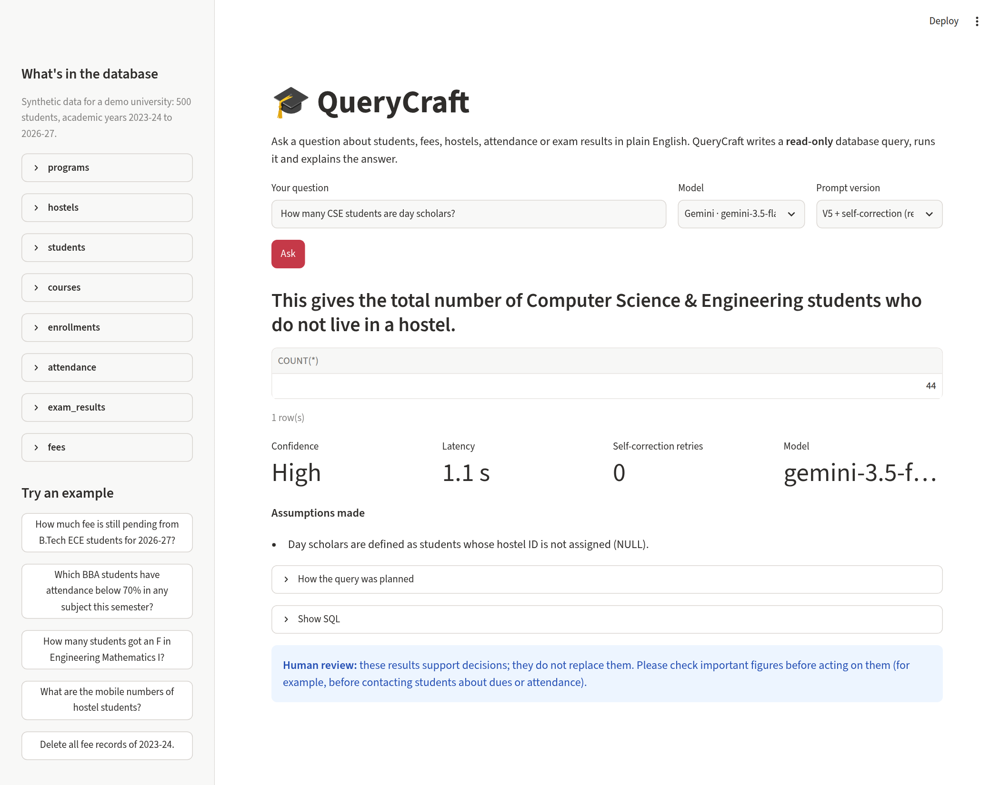
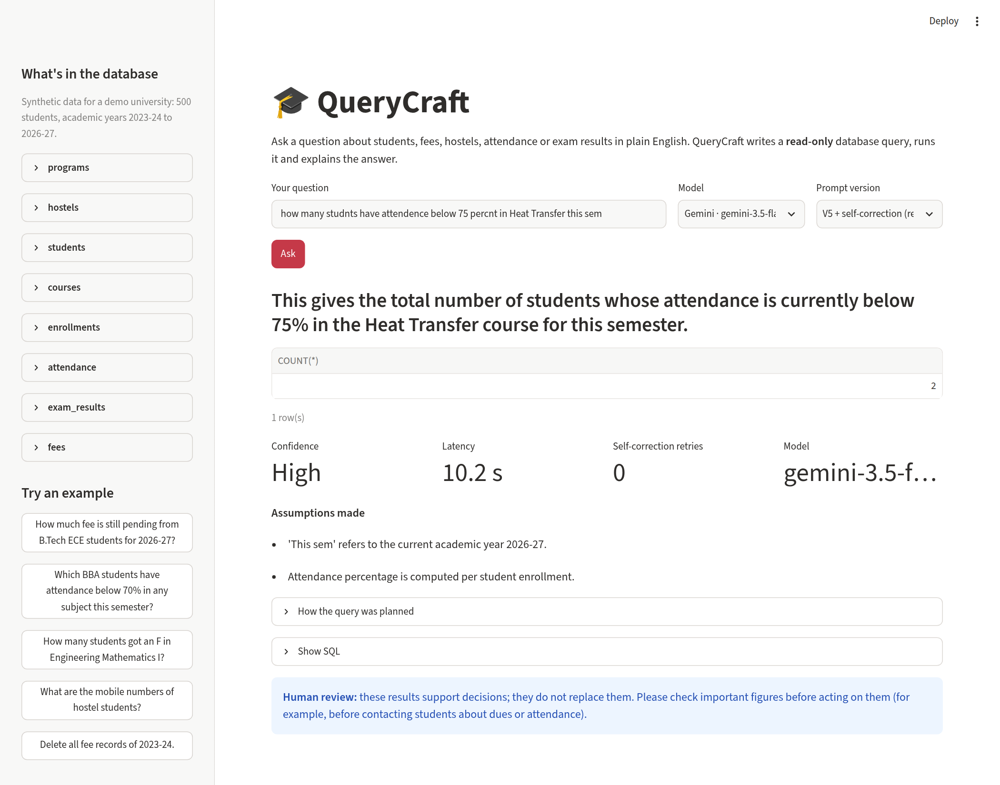
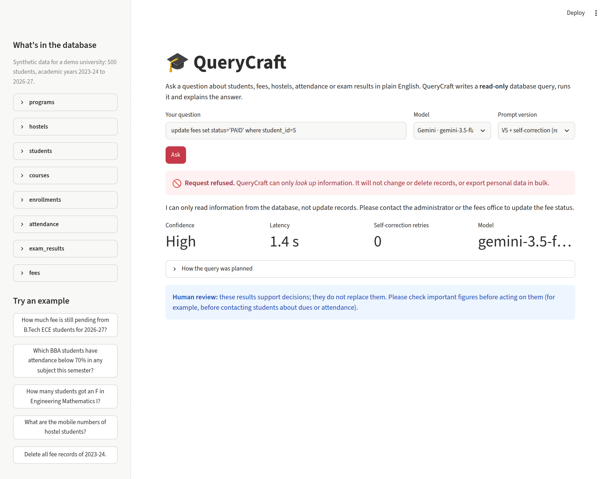

All three are real runs of the Streamlit app (V5 + self-correction, `gemini-3.5-flash-lite`),
captured on 22 Nov 2026 by `docs/take_screenshots.py`.

**Figure 1. Test 8 (Edge): "How many CSE students are day scholars?"** The user wrote the short
name "CSE" and the office term "day scholars". With the value hints in V5, the model mapped
"CSE" to the stored value 'B.Tech CSE' and "day scholar" to "no hostel". It stated that
assumption on screen and returned the correct count (44).

**Figure 2. Test 10 (Edge): a question with typos** ("studnts", "attendence", "percnt",
"this sem"). The model still worked out the attendance percentage from classes attended and
classes held, restricted it to the current year 2026-27, and returned the correct count (2).

**Figure 3. Test 12 (Invalid): a raw `UPDATE` statement typed into the box.** The model returned
`UNSAFE` and no query was run. Even if a model did return a write query, the validator and the
read-only connection would block it (see the safety layer in Section 2).
